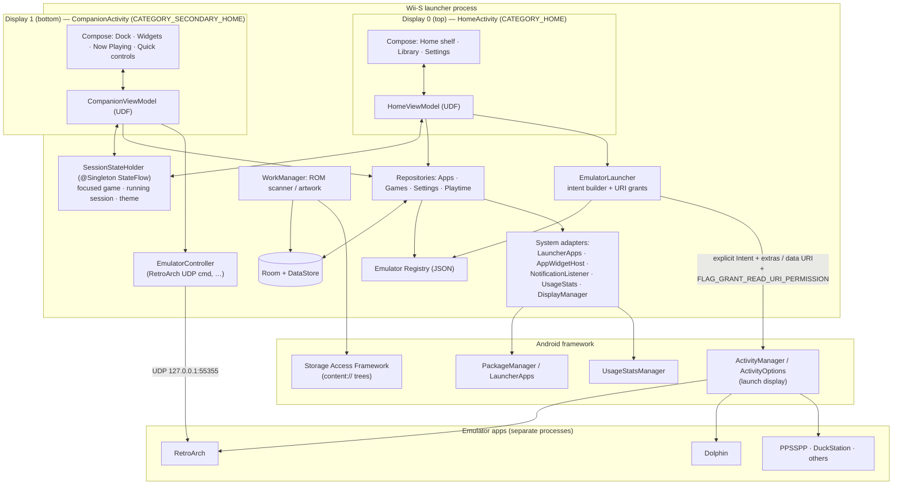
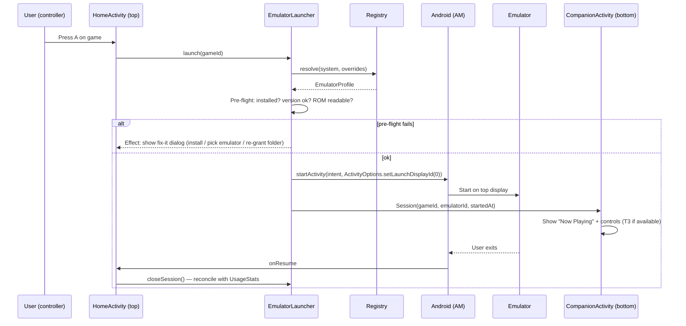

# Wii-S — Technical Blueprint & Development Roadmap

**Target device:** AYN Thor Max (dual-screen Android handheld)
**Phase:** 1 — Discovery & Architecture → Milestone 0 in progress
**Status:** Approved with the decisions below. Milestone 0 code is in the repo; the hardware spike (`docs/SPIKE.md`) is pending.

## Decision log

| # | Decision | Outcome |
|---|---|---|
| D1 | Stack | Delegated to me: "most efficient". Kotlin + Compose + UDF, as proposed, with two simplifications for Milestone 0 (see below) |
| D2 | Android support | **Thor's Android 13 only**: `minSdk 33` |
| D3 | Distribution | **GitHub downloads** (CI artifacts + tagged Releases); no Play Store constraints |
| D4 | Emulators | RetroArch, Dolphin, PPSSPP, DuckStation, **Cemu, Azahar, Eden, GameNative, melonDS, NetherSX2, XenDroid** ("Zen droid", confirmed) |
| D5 | Device | **Thor Max**; owner can run `adb` |
| D6 | Milestone 0 scope | Approved as written |
| D7 | Dual-screen mode | **Mode B** (launcher places the companion on the bottom display), forced by the spike results below |
| D8 | Iteration 1 scope | Approved: bottom-screen reliability, 120 Hz, controller polish, shelf home layout, performance numbers |
| D9 | Design control | **The owner decides every design detail.** Hybrid mood approved as a direction. All values are proposals until approved in the Design Workbench; see `docs/DESIGN.md` |
| D10 | Box art | Start now with no-account sources (your art folder, libretro thumbnails). Other services researched in `docs/SCRAPING.md`; which to add is the owner's call |
| D11 | Sounds | Interface sounds on, synthesised from the theme; the owner can replace any sound with their own file on the device |
| D12 | Look and layout (Draft 2) | From the owner's inspiration pictures: frosted light glass over the focused game's art; Jump back in + systems grid + recent row; art + app dock on the bottom screen; full-art tiles in a console-colour ring with a console line drawing; focus by grow and bounce. Values open until approved (`docs/DESIGN.md`) |
| D13 | Iteration 3 scope | Build Draft 3 into the launcher (0.3.0): hero home, navigation dock, art background and glass, system view, bottom screen following systems |

**Stack simplifications (efficiency):**
- **No Hilt yet.** The graph is about a dozen singletons, so a hand-written `AppGraph` replaces Hilt. That means no annotation processing, faster builds and a smaller APK. Revisit if the graph grows.
- **No Room yet.** The library is cached as one JSON file, which loads instantly for thousands of games. Room comes in when we need queries (search, collections, metadata).
- **No All Files Access.** ROM folders are read through SAF. For path-only emulators (RetroArch), the path is derived from the SAF document ID and the emulator opens it with its own storage access. The launcher never needs the broad permission.
- Detekt/ktlint deferred; CI runs Android Lint and unit tests.

## Milestone 0 spike results (Thor Max, firmware `Thor_V1.0.0.377`, 2026-11-13)

| Finding | Value | Consequence |
|---|---|---|
| Top screen | Display 0, 1080×1920 (portrait-native panel), reporting **60 Hz** | Iteration 1 requests the highest refresh mode explicitly |
| Bottom screen | **Display 4**, "Screen-2", 1080×1240, 60 Hz, flags `PRESENTATION`, **no** `SHOULD_SHOW_SYSTEM_DECORATIONS` | Android never starts any SECONDARY_HOME on it, so **mode A is impossible on this firmware**. Display ID is not 1, so it is never hard-coded |
| Mode B (self-placed companion) | **Works** | **Chosen mode (D7).** `CompanionPlacer` places it on Home resume and on display on/added events. The window is non-focusable, so the controller stays on the top screen |
| Other launchers present | `com.iisulauncher` was default HOME; stock Launcher3 owns `config_secondaryHomePackage` | Wii-S must be set as the default Home app; no conflict otherwise |
| Emulators | All 11 activities resolve. Dolphin, NetherSX2 and XenDroid confirmed by real launches | Registry entries for those three marked `verified` |
| Controller | Feels fine with stock Compose focus | Iteration 1 focus work narrowed to stick navigation and focus restore |

## Iteration 1 results (0.1.0-i1 on Thor Max)

| Metric | Measured | Budget |
|---|---|---|
| Cold start → first frame | 78 ms | ≤ 500 ms |
| Resume → frame | 56 ms median | ≤ 150 ms |
| Janky frames | 0 / 918 (0.00 %) | < 1 % |
| Refresh | Both panels offer 60 and 120 Hz; launcher requests 120 but runs at 60, so a system setting is likely capping it | — |
| Library | 58 games after folder-name normalisation and archive support (was 16). DS fixed; Switch games not found in `Download/ROMs` | — |
| Navigation | Shelves feel good; focus returns to the last played game | — |

---

## Iteration 2: design system (in progress)

| Piece | State in 0.2.0-i2 |
|---|---|
| Theme as data | Every visual and audio detail is a token in `theme.json` (143 details). The launcher draws only from it |
| Design Workbench | Published privately. Live mockup of both screens, every token editable with per-detail approval. Choices save where Claude reads them |
| Theme import on device | System → Theme → Import theme file. Google Fonts download once and are cached |
| Sounds | 7 events synthesised from the theme, same samples as the workbench. Per-event custom files: System → Sounds |
| Haptics | Per event, from the theme |
| Box art | Your art folder + libretro thumbnails, cached, with coverage shown in the System report |
| Stack note | The Compose UI renders from theme tokens; `WiisTile` implements focus scale, lift, spring, bob, ring, glow, soft/hard shadow and press-in |

Next: the owner reviews and approves in the workbench, then I bake approved values into `default.json`. Choosing scraping services (see `docs/SCRAPING.md`) adds the next art sources.

## Iteration 3: Draft 3 in the launcher (0.3.0-i3)

| Piece | State in 0.3.0-i3 |
|---|---|
| Hero home (`layout.games: "hero"`) | Jump back in card, systems grid (A opens a system's games, B returns), recent row, caption in the header, status pill with live battery, Wi-Fi and clock. Shelves and grid layouts remain selectable |
| Navigation dock | Along the bottom of the top screen: L1, Home / Apps / System, R1, then app shortcuts. Y on an app changes it; the choice is a device setting |
| Art background | The focused game's art, blurred once per game at low resolution (`ui/Backdrop.kt`, Gaussian via three box blurs) and drawn scaled up, so it costs a plain image per frame. Systems show a pool of their colour |
| Frosted glass | Translucent fill plus edge over the already blurred background; no per-panel backdrop blur |
| Fidelity to the workbench | Colour mixing in sRGB like the workbench, CSS-style gradients, shadows and single-line boxes. Screenshot tests put the device rendering within about 1 dp of the workbench |
| Bottom screen | Follows highlighted systems; the "artDock" layout (art + app dock) is implemented for themes that choose it |
| Screenshot tests | Robolectric + Roborazzi render the real screens at 833 × 468 dp. Opt-in: `./gradlew :app:testDebugUnitTest -Pscreenshots` (CI skips them) |

Open design questions from this iteration are in `docs/DESIGN.md` (marked "Proposed, not in the workbench").

## 0. Device assumptions (to verify on hardware)

The architecture depends on how the Thor exposes its second screen, so it needs to be checked on a real unit before any production code depends on it.

| Assumption | Expected | Why it matters | How we verify (48h spike) |
|---|---|---|---|
| Top screen | ~6" AMOLED, 1920×1080, up to 120 Hz | Primary "TV-style" UI, frame budget 8.3 ms | `adb shell dumpsys display` |
| Bottom screen | ~3.9" AMOLED, ~1240×1080, touch | Companion UI, touch-first | Same |
| Bottom screen exposed as a standard Android secondary `Display` | Yes, with system decorations | Decides whether we can use `SECONDARY_HOME` (clean) or must fall back to launching our own activity on display 1 | `DisplayManager.getDisplays()`, `dumpsys window displays`; install a stub launcher and check what appears on display 1 |
| OS | Android 13 (API 33) | Sets `minSdk`/`targetSdk` and permission model | `getprop ro.build.version.sdk` |
| SoC | Snapdragon 8 Gen 2 (Pro/Max), 865 (Lite) | Performance budgets must hold on the Lite | Test on the slowest variant you have |
| OEM handling of the bottom screen | AYN ships its own dual-screen controls | The OEM may "own" display 1 and override us | Spike: see whether our secondary activity survives a screen toggle / sleep |

**Biggest technical risk in the project:** if AYN's firmware reserves the bottom display, the dual-screen features fall back to a weaker mode (§4.4). Everything else in this plan is standard Android.

---

## 1. Technology stack recommendation

| Layer | Choice | Justification | Rejected alternative |
|---|---|---|---|
| Language | **Kotlin 2.x** (K2 compiler) | Coroutines/Flow are the backbone of the async model; null safety; first-class Compose | Java: more code, no Compose |
| UI | **Jetpack Compose** (BOM-pinned) + **custom design system** on top of Material 3 foundations | Animation APIs (spring physics, shared elements) are what the "modern polish" side of the aesthetic needs; one toolkit for both screens | Views/RecyclerView: faster cold paths, but the bespoke motion work would cost several times more. Game engine (Unity/Godot): heavy, poor system integration, bad for battery |
| Architecture | **MVI-flavoured UDF**: `ViewModel` → immutable `UiState` via `StateFlow`, intents in, one-shot effects out | A launcher has a lot of concurrent inputs (app installs, scans, controller, two screens). One immutable state per screen makes those deterministic and testable, and it suits Compose's skipping | Plain MVVM with many mutable LiveData/StateFlows: works, but state across two displays drifts out of sync |
| DI | **Hilt** | Both display activities live in one process and share `@Singleton` repositories, which gives one source of truth for both screens | Koin: runtime resolution, errors surface late |
| Persistence | **Room** (game library, playtime, collections) + **Proto DataStore** (settings/theme) | Room gives indexed queries over 10k+ ROMs and reactive `Flow` queries | Raw SQLite / JSON files |
| Images | **Coil 3** with a size-bucketed disk cache | Box art grids are the main memory risk; Coil handles downsampling and works naturally with Compose | Glide: heavier, View-oriented |
| Background work | **WorkManager** (library scans, artwork fetch) + coroutines | Survives process death; scans resume | Foreground service: unnecessary |
| Serialization | **kotlinx.serialization** | Emulator registry and theme packs are JSON | Gson/Moshi |
| Networking (Phase 2) | **Ktor client** or OkHttp | Artwork/metadata scrapers | — |
| Performance tooling | **Baseline Profiles**, **Macrobenchmark**, **JankStats**, Perfetto | Launchers are judged on latency, so we measure from day one | — |
| Quality | Detekt + ktlint, JUnit5 + Turbine, Compose UI tests, Paparazzi screenshots | Screenshot tests stop the visual design from regressing between iterations | — |
| Build | Gradle version catalog, **convention plugins**, multi-module | Faster incremental builds; enforced boundaries | Single module |

### Module layout

```
:app                      // HOME + SECONDARY_HOME activities, DI wiring
:core:designsystem        // tokens, typography, sounds, haptics, motion specs, components
:core:model               // pure Kotlin domain models
:core:data                // repositories (apps, games, settings)
:core:database            // Room
:core:system              // LauncherApps, AppWidgetHost, notifications, displays, battery
:core:input               // controller/D-pad focus engine, button mapping
:feature:home             // top-screen shelf / channel grid
:feature:companion        // bottom-screen UI
:feature:library          // game library, systems, collections
:feature:settings
:emulator:registry        // data-driven emulator definitions (JSON)
:emulator:launch          // intent builder, URI permissions, session tracking
:emulator:control         // runtime control (e.g. RetroArch network commands)
:benchmark                // Macrobenchmark + baseline profile generator
```

---

## 2. High-level architecture



### Key data flows

1. **Pick a game:** controller input on top screen → `HomeViewModel` → `SessionStateHolder.focusedGame` → bottom screen shows details/artwork/playtime right away (shared in-process state, no IPC).
2. **Launch:** `EmulatorLauncher` resolves *system → emulator profile → Intent*, grants URI read permission, starts the emulator on display 0 via `ActivityOptions.setLaunchDisplayId(0)`, and records a session start.
3. **During play:** the bottom screen stays on our `CompanionActivity`, which becomes a "Now Playing" panel with quick controls (save/load state, pause, screenshot, exit) where the emulator supports it.
4. **Return:** the user presses Home or quits the emulator → `HomeActivity.onResume` → session closed, playtime reconciled against `UsageStatsManager`, "recently played" updated.

---

## 3. Feature prioritization matrix

Effort: S ≤ 2 days, M ≤ 1 week, L > 1 week. Value: how much it serves the core pitch (dual-screen Nintendo-era game launcher).

### MVP (v0.1 → v0.5)

| # | Feature | Value | Effort | Notes |
|---|---|---|---|---|
| M1 | Default HOME on top screen; app grid via `LauncherApps` with live install/uninstall updates | Critical | S | Foundation |
| M2 | Bottom-screen companion (`SECONDARY_HOME`) | Critical | M | Depends on spike (§0) |
| M3 | Controller-first focus engine (D-pad/stick, A/B, shoulder paging, haptics + UI sounds) | Critical | M | Compose focus alone is not enough; custom spatial focus layer |
| M4 | Design system v1: tokens, chunky focus states, spring motion, light/dark, original sound set | Critical | M | See §6 |
| M5 | ROM folder import via SAF; scanner with extension-to-system mapping | Critical | M | Background, incremental, resumable |
| M6 | Emulator registry + one-tap launch for RetroArch, Dolphin, PPSSPP, DuckStation | Critical | M | Data-driven, per-system default + per-game override |
| M7 | Library views: by system, recently played, favorites | High | S | |
| M8 | Playtime tracking + last-played | High | S | `UsageStatsManager` |
| M9 | Bottom-screen "Now Playing" panel during gameplay | High | M | Signature dual-screen feature |
| M10 | Performance baseline: baseline profile, Macrobenchmark in CI | High | S | Non-negotiable |

### Phase 2 (v0.6 → v1.0)

| # | Feature | Value | Effort |
|---|---|---|---|
| P1 | Artwork/metadata scraping (user-supplied ScreenScraper / IGDB credentials), local media folder support | High | L |
| P2 | Widget host on the bottom screen (`AppWidgetHost`, bind flow, resize) | High | M |
| P3 | RetroArch runtime control (save/load state, pause, screenshot) from the bottom screen | High | M |
| P4 | Collections, search with on-screen controller keyboard | Medium | M |
| P5 | Notification badges/peek on bottom screen (`NotificationListenerService`) | Medium | S |
| P6 | App shortcuts (`LauncherApps.getShortcuts`), pinned shortcuts | Medium | S |
| P7 | Theme engine: user theme packs (JSON + assets), dynamic color from box art | Medium | M |
| P8 | Backup/restore of library + settings | Medium | S |
| P9 | Screen-swap / single-screen mode | Medium | M |

### Future enhancements

| Feature | Notes |
|---|---|
| Per-game controller profiles and emulator settings overrides | Requires per-emulator config-file writers |
| Game-specific bottom-screen layouts (e.g., second-screen for DS/3DS titles is handled by the emulator; we only coordinate) | |
| Achievements display (RetroAchievements API) | User-supplied key |
| Cloud sync of playtime/collections | Needs a backend; out of scope until asked |
| Plugin API for third-party emulator definitions | Registry format becomes public contract |
| Ambient "attract mode" / screensaver with video snaps | Battery cost to measure |

---

## 4. Emulator integration — detailed design

### 4.1 Integration model

Android emulators do not share an API. The only reliable, universal channel is **launching an explicit Intent** with emulator-specific extras or a data URI. Runtime control is possible only where an emulator exposes a channel (RetroArch's network command interface is the main one). The design therefore has three tiers:

| Tier | Capability | Mechanism | Coverage |
|---|---|---|---|
| T1 Launch | Start a ROM in a specific emulator/core | Explicit `Intent` (component + extras/data) | All supported emulators |
| T2 Observe | Know a session started/ended; playtime | Our activity lifecycle + `UsageStatsManager` events for the emulator package | All |
| T3 Control | Save/load state, pause, screenshot, quit | RetroArch: UDP network commands on localhost. Others: none (bottom screen shows info only) | RetroArch at launch; others if they add an API |

### 4.2 Emulator registry (data-driven)

Emulator definitions live in versioned JSON, not code, so we can add or fix an emulator without an app release (bundled file in MVP; optional remote update later).

```json
{
  "id": "retroarch",
  "package": "com.retroarch",
  "activity": "com.retroarch.browser.retroactivity.RetroActivityFuture",
  "romPassing": "PATH_EXTRA",
  "extras": {
    "ROM": "{rom.path}",
    "LIBRETRO": "/data/data/com.retroarch/cores/{core}_libretro_android.so",
    "CONFIGFILE": "/storage/emulated/0/Android/data/com.retroarch/files/retroarch.cfg"
  },
  "flags": ["NEW_TASK", "CLEAR_TASK"],
  "control": { "type": "retroarch_udp", "port": 55355 },
  "systems": {
    "snes": { "core": "snes9x" },
    "gba":  { "core": "mgba" },
    "n64":  { "core": "mupen64plus_next" }
  }
}
```

`romPassing` strategies:

| Strategy | Used by (examples) | Requirement |
|---|---|---|
| `CONTENT_URI_DATA` — `setData(content://…)` + `FLAG_GRANT_READ_URI_PERMISSION` | PPSSPP and other SAF-aware emulators | SAF tree grant only |
| `CONTENT_URI_EXTRA` — URI string in an extra + `ClipData` grant | Some newer forks | SAF tree grant only |
| `PATH_EXTRA` — absolute file path in an extra | RetroArch, Dolphin (`AutoStartFile`), DuckStation (`bootPath`) | We must resolve a real path, which needs All Files Access (§4.5) |

The live registry is `emulator/src/main/assets/emulators.json`. Its launch definitions were cross-checked against ES-DE's Android find rules. Each entry stays `verified: false` until the spike confirms it on the Thor Max. The spike report lists, for every emulator, the installed package and version and whether its activity resolves. When an activity doesn't resolve, it also lists that package's exported activities, so one report is enough to fix a broken entry.

| Emulator | Systems | Packages tried, in order | ROM handed over as |
|---|---|---|---|
| RetroArch | NES, SNES, N64, GB/GBC/GBA, Genesis, (PSX, PSP, NDS alt.) | `com.retroarch.aarch64`, `.ra32`, `com.retroarch` | File path + core `.so` |
| Dolphin | GameCube, Wii | `org.dolphinemu.dolphinemu` | SAF URI in `AutoStartFile` |
| PPSSPP | PSP | `org.ppsspp.ppssppgold`, `org.ppsspp.ppsspp` | SAF URI as data |
| DuckStation | PS1 | `com.github.stenzek.duckstation` | SAF URI in `bootPath` |
| Cemu | Wii U | `info.cemu.cemu`, `info.cemu.Cemu` | SAF URI as data |
| Azahar | 3DS | `org.azahar_emu.azahar`, AzaharPlus, Lime3DS | SAF URI as data |
| Eden | Switch | `dev.eden.eden_emulator`, legacy, nightly | SAF URI as data |
| melonDS | DS | `me.magnum.melonds`, MelonDualDS, nightly | SAF URI in `uri` |
| NetherSX2 | PS2 | `xyz.aethersx2.android`, Turnip variants | SAF URI in `bootPath` |
| XenDroid | Xbox 360 | `xendroid.compose` | SAF URI as data |
| GameNative | Steam | `app.gamenative` | Steam app id read from a `.steam` file |

### 4.3 Launch sequence



### 4.4 Dual-screen behaviour and fallback

| Mode | When | Bottom screen during gameplay |
|---|---|---|
| **A. Secondary home (preferred)** | Thor exposes display 1 with system decorations; Android resolves `SECONDARY_HOME` from the default launcher's package | Our `CompanionActivity` stays resident |
| **B. Self-placed activity** | `SECONDARY_HOME` is overridden by the OEM, but we may start activities on display 1 | We start `CompanionActivity` on display 1 with `setLaunchDisplayId(1)` at boot and on resume |
| **C. Single-screen** | OEM blocks third-party activities on display 1 | Companion UI collapses into a top-screen side panel; MVP still ships |

DS/3DS emulators that use both screens themselves will take display 1 while running. The companion steps aside and comes back when the session ends.

### 4.5 Permissions

| Permission | Purpose | Type | Trade-off |
|---|---|---|---|
| `QUERY_ALL_PACKAGES` *or* `<queries>` with `MAIN/LAUNCHER` intent | Enumerate apps and detect emulators | Normal (manifest) | Launchers legitimately need it; Play policy allows launchers |
| SAF persistable tree URIs | Read ROM folders | User grant per folder | Most private option; slower directory walks (mitigated by indexing once) |
| `MANAGE_EXTERNAL_STORAGE` (All Files Access) | Needed **only** for path-based emulators (RetroArch, Dolphin, DuckStation) | Special app access, user toggles in Settings | Broad access. Only requested when the user adds a path-based emulator, with an explanation screen first |
| `PACKAGE_USAGE_STATS` | Accurate playtime, "is emulator in foreground" | Special app access | Optional; if refused, playtime falls back to launch→resume timing |
| `BIND_APPWIDGET` (via `ACTION_APPWIDGET_BIND` consent) | Widgets (Phase 2) | Per-widget user consent | Standard |
| `BIND_NOTIFICATION_LISTENER_SERVICE` | Badges (Phase 2) | Special app access | Opt-in only |
| `INTERNET` | RetroArch UDP on localhost, scraping (Phase 2) | Normal | Localhost UDP still needs it |
| `VIBRATE` | Haptics | Normal | — |

There is no root requirement and no accessibility-service hack. We avoid both on purpose.

### 4.6 Runtime control (T3) — RetroArch

- Requires `network_cmd_enable = "true"` in RetroArch's config. We detect it and offer a guided fix; we never edit the user's config silently.
- Commands sent as UDP datagrams to `127.0.0.1:55355`: `SAVE_STATE`, `LOAD_STATE`, `STATE_SLOT_PLUS/MINUS`, `PAUSE_TOGGLE`, `SCREENSHOT`, `MENU_TOGGLE`, `QUIT`; `GET_STATUS` for state readback.
- Security: localhost only, no listener on our side. Any local app could send the same commands to RetroArch, so we add no new exposure, but the guided-setup screen says so plainly.

---

## 5. Performance budgets (enforced in CI via Macrobenchmark)

| Metric | Budget | Measured on |
|---|---|---|
| Home press → top screen interactive (warm) | ≤ 150 ms | Thor Lite (slowest SoC) |
| Cold start → first frame | ≤ 500 ms | Same |
| Emulator return → home interactive | ≤ 200 ms | Same |
| Library grid scroll, 2,000 items | < 1% janky frames @ 120 Hz | Same |
| Idle CPU (both screens static) | ~0%, no running animations, no polling | `top`, Perfetto |
| Memory (PSS, library loaded) | ≤ 180 MB | `dumpsys meminfo` |
| Initial scan of 5,000 ROMs | ≤ 20 s, UI stays responsive | Background WorkManager |

Techniques: baseline profiles; stable/immutable UI models for Compose skipping; `LazyGrid` keys and content types; downsampled artwork cached at grid size; no blur on the hot path (pre-rendered textures instead); animations paused when the screen is off or the companion is hidden; lifecycle-aware Flows (`collectAsStateWithLifecycle`).

---

## 6. Visual direction: "Retro warmth × modern polish"

The look takes cues from Nintendo console UIs from the 2000s to the 2020s. **All assets, sounds, fonts, and names are original.** No Nintendo logos, fonts, system sounds, icons, or trade dress are copied. The *feel* is the target, not the look of any particular console menu.

| Retro warmth | Modern polish |
|---|---|
| Rounded, chunky tiles with a soft bevel and visible "press-in" | Spring-physics motion with overshoot; shared-element transitions (tile → detail) |
| Saturated, friendly palette with per-system accent colours | Dynamic colour derived from focused box art, crossfaded |
| Tactile feedback: short UI sounds and haptic ticks on focus and select | 120 Hz-tuned animation curves; parallax on the top-screen shelf |
| Bold, legible type at couch distance | Generous whitespace, clean information hierarchy |
| Playful idle details (subtle tile bob on focus) | Restraint: decorative motion stops when idle to protect battery |

The design-system deliverable comes in iteration 2: a token sheet (colour, radius, elevation, motion specs, sound map) plus a clickable mockup for both screens, which you approve before any feature UI is built.

**Naming note:** "Wii-S" is close to a Nintendo trademark. That is fine for a private project, but if you ever plan to distribute this, rename it before release.

---

## 7. Roadmap & first milestone

### Iteration cadence

Each iteration runs **Plan → Construct → Review → Fix → Ship** and ends with a stop for your approval.

| Iter. | Duration | Goal | Approval gate |
|---|---|---|---|
| 0 | 48 h | Scaffold + hardware spike (below) | Spike report: chosen dual-screen mode A/B/C |
| 1 | 1 wk | Top-screen home: apps, controller focus engine, perf harness | Benchmarks meet budget |
| 2 | 1 wk | Design system v1 + mockups for both screens | Visual sign-off |
| 3 | 1–2 wk | ROM import, scanner, library UI | Scan + scroll budgets |
| 4 | 1–2 wk | Emulator registry + launch (4 emulators) + playtime | End-to-end play on device |
| 5 | 1 wk | Bottom-screen companion + Now Playing | MVP release candidate (v0.5) |
| 6+ | — | Phase 2 items in matrix order | Per feature |

### Milestone 0 — the first 48 hours

**Goal:** turn the device unknowns into facts and have a skeleton that builds, installs, and renders on both screens.

| # | Deliverable | Done when |
|---|---|---|
| 1 | Gradle multi-module skeleton, version catalog, convention plugins, Detekt/ktlint, GitHub Actions CI building a debug APK | CI green; APK downloadable as a build artifact |
| 2 | `HomeActivity` (HOME/DEFAULT) and `CompanionActivity` (SECONDARY_HOME) rendering placeholder Compose screens | Installed on Thor, set as default launcher, **each screen shows the right activity**, or the spike documents why not |
| 3 | Display spike app screen: dumps `DisplayManager` info, tries modes A/B, logs results | Written spike report choosing mode A, B, or C |
| 4 | App list on top screen via `LauncherApps`, launch on A, D-pad focus works | Can launch any installed app with the controller alone |
| 5 | Emulator launch proof: SAF-pick one folder and launch one ROM in RetroArch **and** one in a URI-based emulator (e.g., PPSSPP) | Both games boot from the launcher |
| 6 | Macrobenchmark module with startup benchmark and first measured numbers | Baseline numbers recorded in the spike report |

**Explicitly out of scope for 48h:** visual design, library DB, artwork, widgets.

**What I need from you for Milestone 0:** this cloud environment has no Android SDK or device, so I can write the code and set up CI, but **you have to sideload the APK on the Thor and send back the spike output** (I will make it one screen you can screenshot, plus an `adb` command list).

---

## 8. Trade-off critique & open decisions

### Trade-offs of this plan

| Decision | Upside | Cost / risk |
|---|---|---|
| Compose over Views | Motion quality, development speed, one toolkit | Slightly worse cold start; mitigated by baseline profiles and being HOME (rarely cold) |
| MVI/UDF | Predictable state across two screens, testable | More boilerplate than plain MVVM |
| Data-driven emulator registry | Fix emulator breakage without releases | JSON schema needs validation and versioning; bad entries fail at runtime, so pre-flight checks are required |
| Optional All Files Access | Supports RetroArch/Dolphin/DuckStation | Broad permission; Play Store would scrutinise it, so sideload/GitHub Releases is the likely distribution |
| Single process for both screens | Instant cross-screen sync, simple | A crash takes down both screens; mitigated by strict error boundaries and crash-loop safe mode |
| No root / no accessibility hacks | Secure, portable, policy-safe | Cannot control non-RetroArch emulators at runtime |

### Decisions I need from you (STOP)

1. **Architecture:** approve Kotlin + Compose + MVI/UDF + Hilt + Room as the stack?
2. **minSdk:** target Thor only (API 33), or also support other Android handhelds (e.g., minSdk 29)? Thor-only is simpler and faster to build.
3. **Distribution:** sideload/GitHub Releases only (allows All Files Access freely) or keep Play Store compliance as a constraint?
4. **MVP emulator set:** RetroArch, Dolphin, PPSSPP, DuckStation, or a different four?
5. **Device access:** which Thor variant do you have, and can you run `adb` commands for the spike?
6. **Milestone 0:** approve the 48-hour scope as written?

I will not start Milestone 0 until you answer these.
